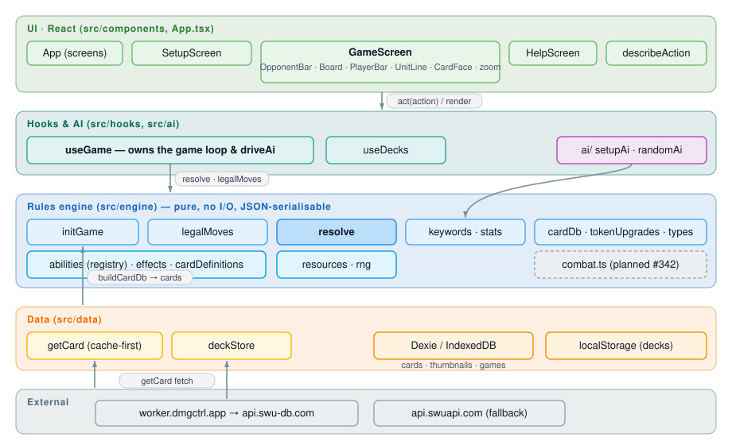
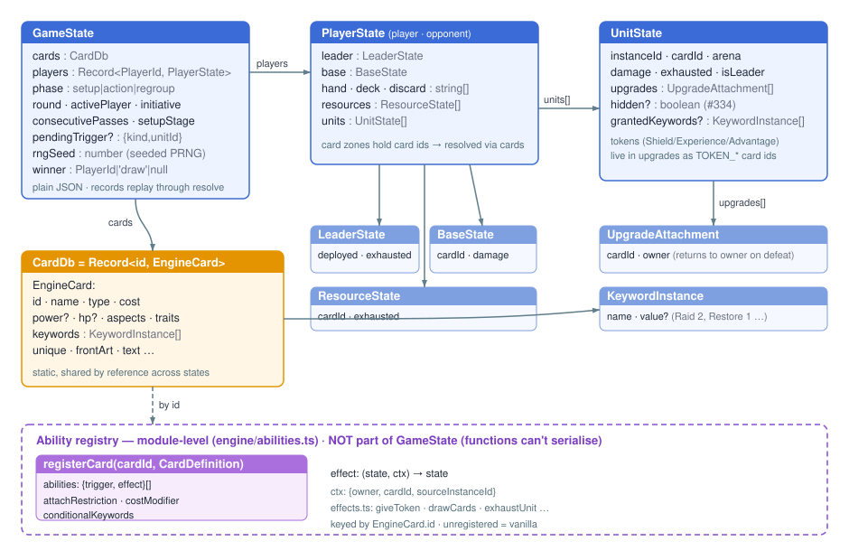
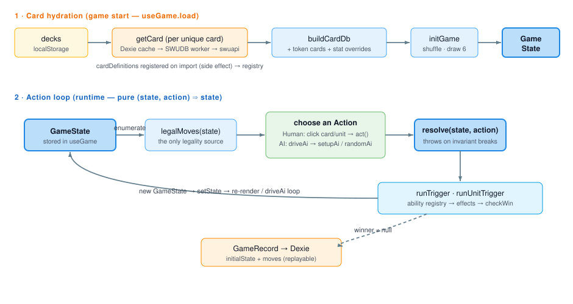

# Sealed: Architecture

Web app for playing SWU Sealed against an AI opponent. Lives at `dmgctrl.app/sealed` (Vite
`base: '/sealed/'`), a separate app from the dmgCtrl PWA on the same origin.
Build plan and epic breakdown: `docs/swu-ai-handoff.html` (repo root).

## Platform, and its place beside the PWA

**Sealed targets a phone and a desktop browser.** The game is laid out for a phone held sideways
and grown for the desktop (see Layout under UI); the remaining screens' redesign is in
[planned-work.md](planned-work.md).

- **Sealed is its own app.** It has its own package, build, tests and docs, and is served under
  `/sealed`. It installs as a PWA of its own ("dmgCtrl Sealed"), with a manifest whose `id`,
  `scope` and `start_url` are `/sealed/` and a service worker scoped to `/sealed/` that precaches
  its code, pages and shipped images; card data stays in IndexedDB and full art stays network-only
  (`SEALED_PWA_MANIFEST` and `SEALED_PWA_WORKBOX` in `sealed/vite.config.ts`). **An update never
  reloads a game**: a new worker waits, and `useUpdateOnDeckScreen` applies it on the deck screen,
  at once or the moment the player leaves a game, since a game lives only in `useGame`'s memory.
  The PWA (X-Wing, SWU tracking) lives at the site root, and its service
  worker leaves `/sealed` alone (`navigateFallbackDenylist` in the root `vite.config.ts`). Sealed
  borrows the PWA's dev server and origin; see [operations.md](operations.md) for how the two
  interact. The two may merge later, so where Sealed copies a PWA pattern it keeps the same shape.
- **Only the UI may share with the PWA.** Sealed's screens import the PWA's shared UI (the
  controls in `controls.tsx`, the log drawer, the tournament layout) from `@pwa-shared/…`, an alias
  for `../src/components/shared` in `vite.config.ts` and `tsconfig.app.json`. Vite dedupes React,
  so those files run on this package's copy. The engine, the AI and the bench import nothing from
  the PWA, so the bench keeps running under Node; a lint rule holds the line.
- **The palette has one source**, `src/styles/tokens.css` in the PWA, which `src/index.css`
  imports. Sealed's Tailwind colour names (`ink`, `line`, `accent`, `red` and the rest) are mapped
  onto those tokens in an `@theme inline reference` block, which writes no variables, so no Sealed
  name can override a shared token of the same name. Code outside a class reads the shared tokens
  directly (`var(--color-text-primary)`, `var(--color-damage)`). Only the colours Sealed alone uses
  (the cunning yellow, the `--color-token-*` pills) are declared as variables here. A test holds
  every `var()` in Sealed to a shared token or one of those.
- **The AI runs off the main thread.** Its search costs about 85 ms a decision on a desktop and
  perhaps 2 to 4x that on a mid-range phone, enough to freeze a phone's UI, so the shipped opponent
  chooses in a Web Worker (see [Game flow at runtime](#game-flow-at-runtime)). Nothing in `src/ai`
  or `src/engine` may depend on the DOM, React or main-thread state, and `GameState` stays plain
  structured-clonable data, which a test holds over every coverage deck.

## Components &amp; integration

Four layers, each depending only on the one below: **UI** (React) → **hooks &amp; AI** →
a **pure rules engine** → **data/network**. The engine does no I/O and is fully
JSON-serialisable; everything above calls into it and re-renders on the returned
state. Card abilities live in a **module-level registry** beside the engine, keyed by
card id, so `GameState` stays pure data.

## The rules engine

The heart of the app is a pure function pair:

- **`legalMoves(state): Action[]`**: the *single source of legality*. Everything the
  active player may do, fully enumerated. The aspect-penalty cost calculation
  (CR 8.1, multiset icon matching) lives here as `effectiveCost`.
- **`resolve(state, action): GameState`**: applies an action produced by the
  generator. Throws on engine-invariant violations (wrong phase, unknown ids,
  game over) but does not re-validate game rules.

Supporting modules: `types.ts` (schema), `cardDb.ts` (SWUDB payload → normalised
static card data; two small data-patch tables feed in here: `upgradeStatOverrides.ts` *fills* the
Power/HP the source omits for the unit upgrades of ASH, HMW, JTL, LAW, LOF, SEC and TS26 (values from
the publisher's card list, and a test fails if a unit upgrade in a bundled set is left uncovered), and `cardDataCorrections.ts` *overrides* values the source
gets wrong, read off the printed card (e.g. Moff Gideon unit cost, Nebulon-C Frigate arena; a test
holds every bundled unit's arena to what its traits print, a Fighter or Capital Ship in space, a
Trooper, Walker, Tank or Speeder on the ground and nothing in space that is not a Vehicle or a
Creature, with the cards printed otherwise named in it); both
drop out per-card once upstream is fixed), `initGame.ts` (setup per CR §5.2: shuffle, draw 6. The game opens in a SETUP
phase with two stages resolved through legalMoves/resolve: mulligan decisions
(CR 5.2.1e, initiative holder first; a base can forbid one, Nabat Village), then each player picks
which 2 hand cards become starting resources (CR 5.2.1f; all pairs enumerated as actions).
The AI's setup choices come from `ai/setupAi.ts`: keep only with a turn-1
play, resource to preserve the early curve),
`resources.ts` (exhausting and readying resources), `payment.ts` (the one door every cost is paid
through, and the paying step the dispatcher raises in front of an action for a player who holds a
Credit token or a unit that pays as a resource; see Paying a cost in
[keywords-effects.md](keywords-effects.md)).

Design properties that matter for later epics:

- **States are plain JSON.** `GameState` round-trips through `JSON.stringify`; the
  static card db hangs off the state but is shared *by reference* between successive
  states, so cloning is cheap for tree search (E5 MCTS).
- **Determinism is serialisable, and the AI is part of it.** The initial shuffle is an
  injectable parameter; everything after it draws from a seeded PRNG whose seed lives ON
  GameState (`rngSeed`). `resolve` advances that seed **once per action**, whether or not
  the action consumed randomness, so the seed is a function of the action sequence alone.
  `randomAi(state)` draws its pick from that seed, making **the AI's move a pure function of
  the state**: the same position always draws the same reply, while any different line of play
  carries a different seed and is free to diverge. Opponents are swappable via
  `UseGameOptions.ai` (tests inject a passive one; smarter rungs slot in the same way), and are
  addressed by name through the registry in `ai/registry.ts`. The **deployed** opponent is a single
  config constant, `OPPONENT_AI` in `src/config.ts` (currently `beam-reply`): shipping a new model is a
  one-line change plus a redeploy, deliberately a reviewed deployment setting rather than a user
  choice.
- **Measurability.** Because the AI is pure and seeded, a headless harness can play thousands of
  games between two named AIs and report reproducible win rates. That harness (`src/bench/`, run with
  `npm run bench`) is the yardstick for the AI series; see [ai-benchmark.md](ai-benchmark.md).
- **Replayability.** A `GameRecord` stores the initial state plus every action;
  replaying them through `resolve` reproduces the game exactly (E7 training data). This holds
  only because the AI is state-seeded: an AI drawing from `Math.random` would make every
  saved record diverge on replay.

Rules verified against the full Comprehensive Rules v7.0: setup (§5.2 incl.
mulligan), action phase/initiative (§1.15, §5.4), regroup (§5.5), attack timing
(§6.3), empty deck (§8.6), Sealed deckbuilding (§10.2). `checkWin` evaluates both
bases so a single action that defeats both is a **draw** (`winner: 'draw'`, §5.6.3).
Every action hands the turn over through `advanceTurn`, which keeps it once for a player holding
`extraActionBy` ("Take an extra action after this one", Kazuda Xiono). The first action phase starts
as the setup ends, and fires "when the action phase starts" on the leaders and bases before the
initiative holder acts. A round normally has one regroup phase; while a unit with
`extraRegroupPhase` is in play as it ends (Max Rebo), its ready step is followed by a second regroup
phase, once a round (`GameState.extraRegroupRound`). A search crosses the regroup in one modelled
step and plays only the one.

**Card behaviour**: the ability framework (`engine/abilities.ts`, see
[abilities.md](abilities.md)) registers per-card effects by id, and unregistered cards play vanilla. A `CardDefinition` carries **triggered abilities**
(fired at `whenPlayed` / `onAttackEnd` / `whenDefeated` / `whenReadies` / `onDefense` /
`whenRegroupStarts`), **activated `actionAbilities`**, and **static hooks**
(`attachRestriction`, `costModifier`, `conditionalKeywords`, `statModifier`,
`damageMultiplier`, `negatesOverwhelm`, `grantedTraits`, `makesLeaderUnit`,
`providesAspects`, `searchModifier`). Keywords are data-driven from SWUDB
`Keywords[]`: Sentinel/Saboteur/Hidden shape legal attack targets; Raid/Grit flow
through `effectivePower`; Overwhelm/Restore/Shielded/Ambush/Support hook play and
combat in the resolver. Combat and defeat go through `engine/stats.ts`
(`effectivePower`/`effectiveHp`) and **`engine/combat.ts`** (`applyUnitDamage` /
`dealDamageToUnit`, extracted so abilities can deal damage without a resolver cycle).
Upgrades attach into `unit.upgrades`; a card upgrade routes to its **owner's**
discard on defeat; token upgrades (Shield/Experience/Advantage/Weakness) and token units live
there too. Optional "may…" decisions resolve through a **pending-choice queue** (`pendingChoices`),
including a mid-combat suspend/resume (`pendingAttack`) for On Defense. Simultaneous **abilities** are a
separate queue (`pendingTriggers`): every event collects what it triggered and resolves the batch one
ability at a time, so their controller orders them and each finishes before the next begins. All 25 ASH
upgrades are implemented. Every ASH leader (both sides) is implemented too. **Still pending**: events,
ability text on ordinary unit cards beyond keywords, and concession.

## Card identity and printings

A card is printed several ways (Normal, Hyperspace, foil, prestige tiers, showcase and more), each
with its **own collector number**, and ProtectThePod exports the printing you actually own. Since
everything the engine keys by card id is written against the Normal number (the ability registry,
`cardDataCorrections`, `upgradeStatOverrides`, the unique rule), a non-Normal printing was
unregistered and played as a vanilla body with no ability at all.

`data/printings.ts` **canonicalises the id during hydration**, before the engine sees anything:
`useGame` rewrites both the fetched cards and the deck lists onto the Normal ids. The engine
therefore never learns that printings exist, and no id-keyed table needs to know either. The
printing's own **art rides along**, so you still see the card you own.

- The join is `Type|Name|Subtitle`, because the set listing returns Normal printings only and so
  cannot be joined on number. Type matters: 13 unit names collide with leader names. Verified
  unambiguous for the whole ASH printing list, not just its Normal rows (925 rows, 264 distinct
  keys, every one of the 661 variants joins to exactly one Normal row).
- **Two tiers.** A bundled static map (`data/bundledPrintings.ts` + `data/printingMaps/*.json`,
  generated by `scripts/generatePrintingMap.mjs <SET>` from the set's full printing listing,
  `/cards/<SET>` with no query) is checked first and resolves synchronously, no IndexedDB or
  network involved. Anything not bundled (another set, or a printing released since the map was
  last generated) falls to the dynamic path: the cached rows of the set and the bundled set
  (`bundledSets.ts`, a complete Normal listing) read as one index, and one `?q=set:XXX` call only
  when the device holds neither.
  The dynamic path has a failure mode worth knowing, for a set that is not bundled: the index is
  built as soon as ANY Normal card for the set is cached, even an incomplete one, so an incomplete
  cache silently prevents the correct, complete network fetch from ever running. The bundled map and
  the bundled sets remove that race for anything they cover; re-run the generator when a new set
  gets ability support or FFG ships a new print run.
- **A card with several Normal numbers is known by the lowest.** IBH prints 38 of its 51 cards at
  two or three Normal numbers, the copies differing only in number, art and price. One rule
  (`normalPrintings` in `data/normalPrintings.ts`) picks the row: the bundled sets and bench fixtures
  are written with it, the triage counts with it and the printing index resolves with it, so the id
  a card is registered under is the id every one of its numbers arrives as. Numbers compare as
  numbers, since rows are stored and listed in the order of their ids as text (IBH 102 before 74).
- **A card printed in more than one set is one card too.** Both joins above work within a set, and
  a reprint is a Normal printing of its own, so neither can reach across: `SEC_258` Grassroots
  Resistance resolved to itself and played as a blank event. `data/reprints.ts` declares those
  cards, naming the id whose behaviour the engine implements and the other sets' Normal ids, and is
  applied last, after the within-set id is known. Extending it is one line per card; variant
  printings need no line of their own, since they reach their set's Normal id first.
  `npm run bench --prefix sealed -- --triage <SETS>` lists cards printed in more than one set and
  marks the ones the table does not yet collapse.
- **Unresolvable cards keep their own id and play vanilla**, which is the previous behaviour, so
  being offline degrades rather than breaks. They are reported through
  `GameValue.unresolvedPrintings`, named in a dismissible notice over the board and included in
  bug reports: the symptom
  (an ability simply not happening) is otherwise indistinguishable from a broken implementation.
- Saved decks keep the printings you own; only play is canonical. Two printings of one card in a
  deck collapse to a single entry, correct for play and merely meaning one of the two arts shows.
- The implemented-cards panel counts Normal printings, so its totals describe the set, not any
  particular pool.

## Data model

`GameState` is plain JSON: it round-trips through `JSON.stringify`, so a `GameRecord`
(initial state + every action) replays bit-identically through `resolve`. The static
card database (`cards: CardDb`) hangs off the state but is **shared by reference**
between successive states, keeping cloning cheap for future tree search. Card zones
(`hand`/`deck`/`discard`) hold card **ids**, resolved against `cards`. An
`UpgradeAttachment` (`{ cardId, owner }`) records who owns each attached upgrade so it
routes to the right discard on defeat, and `unitCard` marks a unit or leader card attached as an
upgrade (a Pilot played with Piloting, or a leader deployed as one), whose abilities answer to its
upgrade side (`upgradeSideId`) and whose modifier is the card's `upgradePower`/`upgradeHp`. A leader
card leaving play this way goes back to its base zone rather than to a pile (`sendAttachmentFromPlay`); a unit holds them in `upgrades`, and a base holds its Fortify
upgrades in `BaseState.upgrades`. A unit controlled by someone other than its owner records the
owner in `UnitState.owner`, and how long that lasts in `controlUntil`: absent is until the regroup
phase starts, `'permanent'` never ends (C-3P0, Galen Erso), and an instance id ends once that unit is
no longer in play (Grand Moff Tarkin), which `resolve` settles once per action rather than at every
way a unit can leave. A resource another player owns records them in `ResourceState.owner` (CR 1.7.5:
it is open information), so it leaves the zone for its owner's discard pile or hand, and a card played
out of the zone is theirs. `effects.ts` holds the doors a resource leaves or arrives by
(`defeatResource`, `returnResourceToHand`, `addResource`). Which card leaves is the ability's pick, but
only the ready and exhausted counts are game state (CR 1.7.4), so the controller keeps as many ready as
the zone allows: a resource leaving is one of the exhausted ones while any is, unless the card says a
ready one (Greater Sarlacc). Token upgrades (Shield/Experience/Advantage/Weakness) and
token units (`TOKEN_*` ids) live in the card db as built-ins. Transient per-attack
grants (`grantedKeywords`, `grantedAbilityCardIds`), once-per-round ability usage
(`usedAbilities`), the **pending-choice queue** (`pendingChoices`), the **triggered-ability queue**
(`pendingTriggers`, with `triggerTurn` recording whose batch is resolving, and `heldTriggers` for a
batch set aside while an attack one of its abilities made runs), a suspended-combat
record (`pendingAttack`), transient stat/keyword modifiers (`lastingEffects`, scoped to the phase, the
round or a single attack), effects left for later (`delayedEffects`, run at the start of the regroup
phase, the start of the next action phase, or a player's next take of the initiative) and the
per-phase event log (`phaseEvents`) all live on the state, JSON-serialisable. Ability *code* can't
(functions don't serialise), so it sits in the module-level **ability registry**,
`registerCard(cardId, …)`, consulted by the engine.

**The state holds everything, and `seatView` is the one account of what a seat may read off it.** A
`GameState` has both hands, both decks in draw order and every face-down resource, because the
resolver needs them. `seatView(state, seat)` (`engine/seatView.ts`) is a pure projection to the same
shape as that seat sees it: the other seat's hand, deck and face-down resources become `UNSEEN_CARD`
placeholders that keep the sizes, the seat's own deck becomes its cards without their order,
`rngSeed` is zeroed since it leads back to a shuffle, and the choices and owed abilities of the other
seat are dropped whole. Two states that differ only in what the seat cannot see have the same view.
It reads one state, so it cannot give back what a seat learned earlier in the game (a card it was
shown, or put on the bottom of a deck), and it hides those too. The training rows use it for the
mover's view (see "The two views of a state" in [ai-benchmark.md](ai-benchmark.md), which lists every
field), and the bot's search starts from it, so the moves it models for the opponent are the ones the
board shows ("The search sees what its seat sees" in [ai-model.md](ai-model.md)). The app does not:
the board draws the human's side from the full state.

## Game flow at runtime

`useGame` owns the loop:

1. Hydrate every unique card in both decks (`getCard`: cache, then the bundled set, then the network).
2. `buildCardDb` → `initGame` → store state; snapshot the initial state for the record.
3. Human acts by clicking cards/units, the action-menu buttons, or a pending-choice
   prompt (pay/play/discard, the "look at a card" / search overlays) → `resolve`.
4. `driveAi`: while the AI is active and the game is live, `driverAction` picks the
   AI's move, resolves, and logs, through action *and* regroup phases (capped at 500 steps as
   a hang guard). `driverAction` is the step the bench's `playGame` takes too: offer to concede
   a certain loss, else the setup heuristic, else the AI.
5. When `winner` is set, the game record persists once to IndexedDB.

**What a game record holds** (`GameRecord`, `data/gameRecords.ts`): the two deck names, the
`winner`, `startedAt` (when the board was dealt, so a rematch starts it again) and `endedAt` (when
the winner appeared), the `initialState`, every move with the seat that made it, and the
`finalState`. Beside those sits its provenance, written when the record is saved because none of it
can be worked out from the moves afterwards:

| Field | Says |
|---|---|
| `undoCount` | How many rewinds the player performed (see "Undo" below) |
| `build` | `{ release, commitId }` of the build that played the game: its rules and AI produced these moves |
| `opponentAi` | The registered name the opponent played as (`OPPONENT_AI`). Absent when the opponent was injected as a function, which has no name |
| `humanSeat` | The seat the person held; the other seat's moves are the AI's |

All four are optional and none is an indexed key, so the `games` store's schema does not change for
them. A field is absent on a record written before it was captured, which means unknown, and it
cannot be backfilled.

**The setup screen reads the records for one thing**: the player's record by matchup
(`matchupRecords`, tallied by `data/matchups.ts` once as the screen opens). A matchup is a leader on
a base against a leader on a base, read from each record's `initialState` and the card data it
carries, so every saved game counts and no deck name or id is involved. Bases are grouped from the
card data alike on both sides: a common base with no ability groups by aspect, a common base with an
ability groups with every common base of its HP (the Force bases, the splash bases), and a rare or
special base stands alone. A leader is matched by name and subtitle. A record with no `humanSeat`
reads as played from the player seat.

**Replay data travels without the card database.** `withoutCards` (`data/replayData.ts`) is the one
place that strips it, and the bug report, the bench's failure fixtures and the game export
(`data/recordExport.ts`) all write the shape it returns: the state's own keys in their own order,
less `cards`. The reader rebuilds the database from the cards the position names. An exported
record also leaves out `finalState`, which replaying the moves produces, and its `id`. See
"Exporting game records" in [operations.md](operations.md) for the file.

**Replaying it is one implementation.** `engine/replay.ts` puts a card database back on a starting
position (`withCardDb`, which names any card the database lacks) and re-resolves the moves to every
state in order (`replayStates`). The test harness that replays a filed report builds on it with the
ASH fixture, and the bench's `--rows` mode builds on it with every bundled set to turn exported games
into training rows, one per move (`bench/trainingRows.ts`, see "Training rows" in
[ai-benchmark.md](ai-benchmark.md)). That transformation is offline and reads only export files:
nothing in the app calls it.

**Sending a game to train the bot goes through one gate.** `recordForCollection`
(`data/collection.ts`) is the only function that turns a record into an outbound payload, and it
returns `null` unless both of these hold:

- the stored `shareGames` setting is `yes` now, which it reads itself, so a caller cannot be wrong
  about consent;
- the record carries `consentedAtFinish`, which `useGame` writes with the record (`consentStamp`)
  only when the setting is `yes` as the winner appears. Opting in therefore covers games finished
  from then on and never one already saved, and opting out stops everything at once.

The payload (`CollectedRecord`) is built by naming each field, starting from the exported form so
the card database and the final state are stripped in one place. A field added to `GameRecord`
stays on the device until it is named there on purpose.

| Sent | Not sent, and why |
|---|---|
| `initialState` without its card database, and `moves` | the deck names: free text the player typed, the one field that could hold a name. `playerLeader`, `playerBase`, `opponentLeader` and `opponentBase` name the decks instead |
| `winner` | the record `id`: it identifies a game, not a person, but would let that game be found again, which the notice says cannot happen |
| `durationMs` | `startedAt` and `endedAt`: the notice names how long a game took, not when it was played |
| `undoCount`, `build`, `opponentAi`, `humanSeat`, each only when the record has it | `finalState`, `consentedAtFinish` |

`initialState` is passed whole, so the list does not guard a field added to `GameState`: that type
holds card ids and counters and must never hold anything the player typed. A payload is replay
data, so the replay harness reads it as it stands.

**One sender posts it** (`data/collectionSend.ts`), and it is the only code that puts a game on the
network. `useGame` hands it each record once the record is saved, and it posts what the gate returns
as it stands to `POST /records` on the card Worker, with no cookies and no referrer. When the gate
returns nothing there is no request at all. Sending never touches play: nothing waits on it and
every failure is silent, with no message, no log line and no second attempt on the spot.

- **A game that could not be delivered is offered again when the app next opens.** Its record id is
  kept in a short list in localStorage (`sealed_collection_pending`, at most 50, oldest dropped
  first), which never leaves the device. On opening, the list is walked oldest first, one request at
  a time, and stops at the first failure, so an unreachable endpoint costs one request per start.
  The gate is asked again on every attempt: a game is dropped from the list when the player has
  opted out since, when the record is gone, or when the endpoint refused the payload itself (a 4xx
  other than 408 and 429), since it would refuse it again.
- **Offline, no request is made** (`navigator.onLine`), and the game waits in the list.
- **A dev build sends nothing** (`isDev`), on finishing a game or on opening.

The local export is separate: the player starts it by hand, it keeps the deck names, and it does not
carry `consentedAtFinish`.

**The Worker stages the payload and keeps nothing else** (`proxy/records.js`, see
[Network](#network)). What it accepts is data, `proxy/recordContract.json`: the field list (a copy
of `CollectedRecord`, so a field added there is refused until it is added here too), the size cap,
and the rule that every string in a payload, keys included, is short and written in the characters
ids use. That last rule is what keeps text a person typed out of storage wherever a later client
might put it. A Sealed test reads the file and holds a real game's payload to it, because a payload
the Worker stopped accepting would otherwise be lost without a sound.

`useGame` reads live state from a ref inside `act` (not a setState updater) so that
under React `StrictMode`, which double-invokes updaters in dev, each action logs
and drives the AI exactly once.

**Every action goes through one `apply`**, the player's and the opponent's alike: it takes the
undo snapshot, appends the move record, resolves, and appends the log lines, all in refs.
`publish` then renders what the refs hold. What varies is only when the opponent's actions are
applied, which `UseGameOptions.opponentDelayMs` decides:

- **Zero or absent: instant.** The opponent's whole reply is applied in a loop before the one
  `publish`, so it lands in the same render as the action that prompted it. This is the hook's
  own default, and what its tests drive.
- **Positive: paced.** The state is published as it stands, with the opponent to act, and its
  actions follow on timers, one at a time, each applied and published with its own log lines.
  `GameScreen` passes the `opponentDelayMs` setting, so this is what a player sees.

The delay is a **floor on the gap between two shown states, not a wait added to it**. Each
step is timed from when the state before it was published; the AI chooses its action a short
moment later (`PAINT_GAP_MS`, so the browser has painted that state before a slow choice
blocks the main thread), and the action is then held only for what is left of the delay. A
choice that took longer than the delay is shown the moment it is made. The AI's own thinking
is neither slowed nor moved: it is the same call either way.

**The shipped opponent chooses in a Web Worker.** Each game gets an `OpponentChooser`
(`hooks/opponentChooser.ts`), made when the game loads and closed with it. `driveAi` asks it for
each action and carries on when it answers, so the pacing above is the same whichever answers:

- **The worker** (`hooks/opponentWorker.ts`, a module worker) is used for the shipped opponent.
  The page posts `{ id, state }` and the worker replies `{ id, action }` with `driverAction`, the
  step the bench takes. The state crosses by structured clone and carries its own card database
  (`state.cards`), so nothing is fetched or built in the worker; the ability registry is module
  state, so the worker fills its own by importing `cardDefinitions`. A search that throws replies
  with the error's message, which is logged, and the opponent stops as it would on the main thread.
- **The main thread** is used for an AI handed in through `UseGameOptions.ai` (the tests), and
  wherever `Worker` does not exist. That chooser answers before `choose` returns, so an instant
  reply is still applied in one synchronous pass. A worker whose script fails to load hands its
  request, and every one after it, to the main thread.

One request is out at a time, and `pendingStepRef` holds `THINKING` while it is, which refuses an
undo exactly as a pending timer does. A reply is matched to its request by id: `cancelOpponent`
(any rewind, a rematch, a change of deck, an unmount) drops the request in flight, and a reply
that arrives after that is discarded. The worker is terminated when its game's effect is cleaned
up. With no delay the player's action and the whole reply are published together once the worker
has answered the last of it, as on the main thread.

While paced actions are pending:

- **The player has no input.** The published state has the opponent active, so `legal` is
  empty and `act` refuses, exactly as it would mid-loop. `undo` refuses and `canUndo` is false
  until the last action is shown, since a rewind takes the whole reply; `cancelChoice` is
  offered only on the player's own turn.
- **Nothing pending outlives its game.** A rematch, a change of deck, an unmount and any rewind
  cancel the timer and any choice the worker is still making, and an action is only ever chosen
  from and applied to the live state.
- **The delay is read at every step**, so changing the setting applies to the turn in
  progress: switched to instant, the rest of the reply arrives with the step already waited on.

Paced and instant play record the same game: the same moves in the same order, the same log
and the same states, since both are the same `apply` over the same deterministic choices. The
benchmark does not use the hook at all (`playGame` calls `driverAction` and `resolve` itself),
so it never waits.

**Undo** keeps a snapshot of the state, log length and move-list length taken before
**each individual action**, the AI's included. `undo()` rewinds to the last snapshot the human
took, which drops the AI's reply along with the player's move, and truncates the move list so
an undone move can never reach a saved record. Depth is unlimited: you can rewind to the
opening mulligan. Three deliberate constraints:

- **It is not an `Action`.** It lives on the hook's return value, so it cannot appear in
  `legalMoves` and the AI cannot pick it, which would otherwise loop forever.
- **It stops at the end of the game**, because the record has been written by then and
  rewinding past it would leave the saved game disagreeing with the screen.
- **The button is offered only when `allowUndo` is set**, which defaults to the build
  (`isDev()`). The gate is presentational, in `GameScreen`: the snapshots are kept either
  way, so turning the setting on mid-game exposes the whole history already recorded rather
  than starting from that moment.

Replaying an undone action reproduces the same AI reply, per the determinism contract above,
so undo cannot re-roll an outcome. It can still rewind past a mulligan, a draw or a search,
which lets the same decision be taken again with the hidden information already seen. That is
why it is off by default: it is a tool for pinning down a defect or practising a line, not part
of playing a game.

Because undone moves are truncated out, a game played with undo replays perfectly and is
otherwise indistinguishable from one played straight through. `useGame` therefore counts the
rewinds it performs and writes the total to the record's `undoCount`, so the E7 training
pipeline can tell a retried line from a played one. A rewind that found nothing to take back
does not count. The field is absent on records written before it existed, which means
provenance unknown rather than zero, and it cannot be backfilled.

**Cancelling a choice** rewinds the same history. `cancelChoice` is set while the human's pending
choice came out of their own action, and rewinds to the last snapshot with no choice pending, so a
follow-up choice cancels the whole action rather than one step of it. `cancelPoint` decides it, and
refuses when the rewind would be more than taking back the player's own move: the AI acted since, the
choice's `source` is the AI's card, or something hidden was seen (either deck, the AI's hand or
resources changed, a look or search choice was pending at any step, or the seed moved further than its
one step per action, meaning a random outcome was drawn). Because those refusals cover exactly what
makes undo a practice tool, cancelling is not gated on `allowUndo`, and it counts toward `undoCount`
like any rewind.

The per-action granularity is finer than `undo` currently needs; it is the substrate for
stepping through history from the log.

**Conceding** is four engine actions, so an offer and its answer are ordinary recorded moves that
replay, undo and reach the saved record like any other:

- `concede` ends the game at once as the acting player's loss (the player's Concede button).
- `offerConcession` asks the other player, handing them the turn; while it stands `legalMoves`
  offers only `acceptConcession` (they win) and `declineConcession` (play resumes and the offerer
  may not offer again that game, which `resolve` enforces).
- None of them is listed as an ordinary move, so no search weighs giving up. Whether to offer is a
  driver's policy, `concessionOffer`: on the bot's own action-phase turn, once a game, when
  `lossIsCertain` holds (every legal move hands the opponent a one-action lethal on their turn).
- A game ended this way records `concededBy`, which the game-over banner reads.

In the bench, `playGame` offers on the same rule and accepts on the other bot's behalf, which ends a
game the moment it is decided without changing who wins it. The coverage sweep turns it off
(`concede: false`), since playing the lethal out is play it exists to exercise.

## User settings

`data/settingsStore.ts` holds the shape, the defaults and the reading of the stored blob;
`hooks/useSettings.ts` wraps it in a context provider around the whole app. Consumers read
`settings` and call one `update(patch)`, so adding a setting is a field and a sheet row
with nothing to wire between them.

Four properties are load-bearing:

- **Defaults may depend on the build.** `allowUndo` and `showBugReport` default to `isDev()`:
  developer tools, on while developing and off in the shipped app, and a user preference
  either way. `defaultSettings()` is a function, not a constant, so the build is read at call
  time and both cases stay testable.
- **Reading never writes.** Persisting a computed default on first load would freeze one
  build's answer into storage and stop it tracking the build. Only an explicit change writes.
- **Every field is validated on load, against its own default.** A stored blob can be corrupt,
  partial or wrongly typed, and none of those may stop the app starting: an unusable value
  falls back to its default and the rest survives. A blob written before a setting existed
  omits it, which reads as that setting's default.
- **Settings are live.** They reach the UI through context, so a change applies to the game in
  progress rather than at the next game. The one setting the game hook itself needs,
  `opponentDelayMs`, is passed by `GameScreen` as a `UseGameOptions` field that `useGame`
  reads at every opponent step, unlike its init-only options.

`opponentDelayMs` is one of `OPPONENT_DELAYS_MS` (zero is instant) and defaults to 500 in every
build. The sheet's stepper walks that list by index, so a stored value outside it, which the
stepper could not show, reads as the default.

`shareGames` is the player's answer about sending finished games to train the bot: `unasked`
(the default in every build), `yes` or `no`. It is opt-in, so only `yes` permits anything, and a
stored value that is none of the three reads as `unasked`: a damaged blob opts nobody in. Three
surfaces write it, and one module reads it to act on it (`data/collection.ts`, see "What a game
record holds" above):

- **The notice** (`components/shareGamesNotice.tsx`), shown while the answer is `unasked`. `App`
  passes it to `SetupScreen` as `notice`, a slot the screen renders last, under Go to game, so it
  never moves the cards or Go; where it does not fit, the page scrolls rather than squeezing them.
  So the notice reads the settings and the setup screen does not. It is a banner in the page, never
  a dialog: it covers nothing and the setup screen works untouched. It has the PWA install banner's
  shape (one raised row: a title, a line under it, the answers at its end) and says what is sent in
  one line, `ShareGamesSummary`, the same words and "What's sent" Help link as the settings switch's
  note. Its two answers are the shared secondary `Button`, so neither is the highlighted one, and
  nothing is chosen in advance.
- **Starting a game.** `App` turns `unasked` into `no` as the first game starts, so ignoring the
  notice is a refusal and the question is put once.
- **The settings sheet**, where a switch maps on to `yes` and off to `no`.

Once the answer is not `unasked`, the notice renders nothing. In its place `ShareGamesPill` (same
file) shows in the setup header, passed as `headerExtra` and rendered immediately before More, and
opens the settings sheet: "Improve the bot" after a no, and a fainter "Your games are improving the
bot" after a yes. It carries no badge, count or animation in either state, and is smaller and
lighter than the icon buttons. The game screen has its own header, so the pill is not shown during
a game. The header row never wraps for it: the label stays on one line, and below Tailwind's `sm`
width (640px) the pill is hidden, leaving More › Settings as the route to the setting.

The surface is the PWA's shared `Sheet` (`SettingsSheet`, "Sealed settings"), built from the
shared `Switch`, `Stepper`, `SegmentedControl` and `ControlRow`, opened from More on the setup
screen (rendered by `App`) and from More in the game (rendered by `GameScreen`). Not a screen:
routing away unmounts `GameScreen` and the game with it, since the game lives entirely in
`useGame`'s state and refs. It reads the context directly rather than taking props, because a
settings form has no caller-held state to be given. Its callbacks besides closing are
`onHelp(section)`, which the "What's sent" link uses to open Help on a single section of the guide,
and `onAppSettings`, which by default leaves for the PWA's Settings page at `/?settings` (the PWA
opens every game's settings there, with Back to game select). The Report a bug switch shows only
where neither phone query matches, since the report itself is desktop only.

The icons for the shared `IconButton` live together in `components/icons.tsx`, the back, more and
log icons copies of the PWA's, so a mismatch between neighbours is visible in one file.

## Help

`HelpPage` (`components/helpPage.tsx`) is one page, "Sealed help", built from `userGuide.md`: a
header with Back, section links (`OptionRow`, the current one pressed) in a column on the left in
landscape and in two rows across the top in portrait, and the sections beside or below them, each
a block of its own in one scrolling column. Tapping a link scrolls to its section, and the current
section follows the scroll. It is a copy of the PWA's help screen (`src/components/helpScreen.tsx`)
in shape and behaviour, so the two apps' help reads alike and a later merge is mechanical.

It **opens at the section for the screen it came from** (`OPENS_AT` in `utils/helpSections.ts`):
Decks from setup, Playing from a game. A link can name another: "What's sent", in the settings
sheet and in the setup screen's sharing notice, opens it at `SHARING_HELP_SECTION`, After the game, which says what sharing games sends.

It covers the screen rather than replacing it, for the same reason settings does: help used to be
a screen, so opening it mid-game unmounted `GameScreen` and the game with it, and coming back ran
`initGame` again on a fresh seed. `App` holds it, so one page serves both screens, and renders it
over whichever screen is mounted and above the settings sheet, so closing help opened from the
sheet returns there. Back or Escape closes it.

**The guide is the page.** `parseGuide` splits the rendered HTML on its headings: the `#` is the
page title, each `##` a section and a section link, and each `###` within a section a topic that
opens on a tap (`components/disclosure.tsx`, shared with Card support's sets), one at a time. A new
`##` therefore appears as a section with no code change. `helpSections.test.ts` pins the section
list and The board's topics, so a renamed heading that `OPENS_AT` or the settings link names fails
the suite. The fan-content disclaimer is the PWA's app help page's, which covers Sealed's cards.

## UI (SetupScreen)

`components/setupScreen.tsx` is built from the PWA's shared controls (`@pwa-shared/controls`:
`Button`, `IconButton`, `SegmentedControl`, `SelectButton`, `OptionRow`, `Switch`, `Sheet`,
`SetupHeaderMark`) in the shape of its X-Wing setup screen: a header (Back, the dmgCtrl mark,
"Sealed", More), a **Your deck** card and an **Opponent** card, and one primary **Go to game**,
disabled until a deck is chosen. It has no native select, checkbox or text box of its own: every
choice opens a `Sheet`, and the only text box is the import sheet's.

- **State is a hook.** `hooks/useSealedSetup.ts` holds what the screen does apart from how it
  looks: the chosen deck (a saved deck's id in `setupStore`, or a generated deck held in memory
  and never stored), the opponent choice, the sets each generator builds from, the caching that
  makes them buildable (`ensureSet`, one fetch per set however many ask) and resolving the opponent
  at Go to game. Linked, the opponent's set is the chosen deck's (its leader's set), so the pool the
  sheet offers leaders from is the one the game builds from.
- **Sheets stack.** The screen keeps a stack of open sheets and shows the top one; a sheet opened
  from another (the opponent's set, leader and base aspect; import from the deck sheet) returns to
  it on close, which is the design's Back. A deck view (`setup/deckView.tsx`) covers the screen at
  z-index 20, under the sheets' 30, so the set sheet opened from the Generate view shows over it.
- **Cards are looked up once.** `hooks/useCardLookup.ts` resolves the cards a deck names through
  `getCard` (cache, bundled set, network) into a session map, and a generator's pool is added whole
  as it loads, so a generated deck shows without a lookup. A card not found shows its id.
- **What a deck says** is `setup/deckSummary.ts`: the list ordered units, upgrades, events by cost
  then name, a type with no cards having no group; the type counts; the cost curve (1 or less, each
  cost to 6, 7 or more); the set from the leader; the aspects, leader's then base's, so a base with
  none (Lake Country) adds nothing. `setup/deckParts.tsx` draws them: the aspect icons (copies of
  the PWA's PNGs in `public/`), the leader and base through `CardFace` at their own landscape shape,
  and the list in CSS columns with each type heading kept with its first card. A tap on any card
  shows it full size in an `OverlayShell`.
- **Three layouts**, by media query (`hooks/useMediaQuery.ts`): landscape (the two cards side by
  side, filling a phone's 844x390 without scrolling, with no saved deck's Generate and Import side
  by side so Go to game stays on screen), portrait (stacked, the deck card taking the
  height the opponent card leaves, with the leader and base on it) and desktop (at least 1024x600:
  the cards in a column with the chosen deck's list beside them). On a phone the two cards share
  one block that fills the height and never shrinks below them, so a notice under Go scrolls the
  page. The portrait query is the one the shared `Sheet` reads, so a sheet and its screen
  agree on the orientation.
- **Back** goes to the site root, which is the dmgCtrl PWA's game select: a different app, so an
  installed Sealed may open it outside its own window.
- **No aspect** is the generator's `NO_ASPECT` base aspect: `generationOptions` lists it last, and
  only for a pool printing a base without an aspect, and `buildDeckForLeader` builds on such a base
  when it is named.

## UI (GameScreen)

The board is drawn with art-dominant cards, not text rows:

- **`CardFace`** renders a card *as its art*, filling a fixed **square slot** (side =
  the card's long edge) so cards never overlap regardless of orientation. Orientation
  follows the rules: units are portrait (landscape when exhausted); bases and undeployed
  leaders are landscape; a deployed leader shows its unit (back) side, portrait. Missing
  or failed art falls back to a text summary (cost/name/power-HP/keywords/abilities).
  Sizing constants live in `cardSizing.ts`; the roll-over zoom drives its `widthPx`. So does
  the one card corner radius, `cardRadius(shortEdge)` (5px at board and hand sizes, 9px at full
  size), used by every card face and by the empty outline a deployed leader leaves.
  Selection/target/actionable highlights are a 2px outline hugging the card edge (1px in /
  1px out, `outline-offset: -1px`) via the `highlight` prop. A target's colour is the choice's
  (or leader ability's) `intent`, mapped once in `components/highlight.ts`: green helps, red
  harms, yellow (`--color-yellow`) is cunning, white attaches a real upgrade card (including one
  placed from hand); a target with no intent is an attack, so red. Accent blue stays selection
  and dimmed accent "can act". A base takes the same colours through `BaseCard`'s `target`. A unit in play is a
  `PhoneUnit` tile (see Layout below): its effective power and HP in discs at its foot, its damage
  over the art, and a badge for each thing on it, all on the non-rotating wrapper so they stay
  upright when the card is exhausted. What a unit carries in full (each upgrade and token by name)
  is in `CardDetail`.
- **Roll-over zoom** (`useCardZoom` + `CardZoomPopover`): **Shift+hover** (mouse, so plain
  hovering doesn't obscure play) or **touch-long-press** shows a full-size, upright
  copy floating above the board (absolute, centred on the source; viewport-edge clamping is not yet
  implemented). Long-press suppresses the click so it doesn't also play/attack; holding **Alt**
  flips a dual-sided leader's face. Shift/Alt come from a shared `useModifierKeys` store (one set
  of listeners, not one per card). The zoom scale is `ZOOM_WIDTH_PX` (cardSizing.ts), one place.
  The popover portals to `document.body` and positions itself from the anchor element supplied by
  `setAnchor`. Two constraints keep that working, both learned from a production-only failure where every card but the board unit stayed invisible: `setAnchor` **must stay
  referentially stable**, since React detaches and re-attaches a callback ref whose identity
  changed, and refs attach bottom-up, so a popover rendered *inside* its anchor would otherwise
  measure a null ref; and a positioning pass that finds no anchor **falls back to centred, never
  hidden**. Dev hid the bug because StrictMode's dev-only double-invoke re-ran the layout effect
  after the ref attached. Assert zoom is *visible*, not merely mounted: presence alone passes
  while the popover is `visibility: hidden`.
- **Described actions and card references**: `describeAction` returns a flat string, which
  throws away *which* card each name refers to, and names are not unique (13 unit names collide
  with leader names), so recovering them by matching text would be wrong. `describeActionParts`
  therefore returns `DescribePart[]`: plain strings interleaved with `{cardId, controller, text}`
  tokens. `partsText(parts) === describeAction(…)` is an invariant pinned by test, which is what
  lets any un-converted branch fall back to a single plain string and simply render without
  references. `CardRef` renders a token bold and colour-coded (accent = you, amber = opponent),
  zooming on **plain hover**: the board's Shift gate exists so hovering the play area doesn't
  obscure it mid-play, which doesn't apply to a line of text. It is a ``, not an `<a>`:
  nothing navigates, so an anchor would mislead a screen reader. **Redacted entries never emit a
  token**, since an opponent's resource pick is hidden information (CR 1.17) and a card reference
  would leak it through the zoom regardless of the text saying "a card". The same holds for every
  card the opponent moves between two hidden zones: one resourced or put on a deck out of a hand,
  and one a search takes without revealing it. A search choice records only which of the cards
  looked at were eligible, so its pick counts as revealed when some card looked at was not
  eligible (a search for a kind of card, which every printing reveals) and as private otherwise.
  A card an answer reveals or discards is public, and `describeActionParts` links it.
- **What an action changed**: the engine returns a state and keeps no record of the effects it
  applied, so an action's own line says what was chosen and nothing about what happened.
  `logEntries` (`utils/boardDiff.ts`) is what `useGame` calls for every action, the player's and
  the AI's: it returns the action's line followed by one `outcome` entry per change `boardChanges`
  finds between the state before and the state after. That covers damage and healing on units and
  bases, upgrades and tokens gained or lost, units taken, leaving and entering play, and cards
  arriving in a discard pile. It runs in the UI only, once per logged action: nothing in the
  engine or the AI search calls it, and `GameState` carries nothing for it. Three properties
  follow from it being a diff:
  - **It says what changed, never why.** It cannot name the card that caused a change or separate
    two effects inside one action, it sees only the net of an action, and damage that lands when a
    later choice is answered is listed under that answer.
  - **It names only what is face up.** A line links a card that was a unit, an upgrade or a token
    in play, or one that arrived in a discard pile. Hands, decks and resources are never read for
    a name, so a card moving between them produces no line. A card that is revealed and stays
    where it was leaves no trace in the state, so the diff cannot report it: such a reveal reaches
    the log only where the answer to a choice carries the card.
  - **It does not repeat the action.** Numbers are always stated, even when the action's line
    already promised them, because one is the choice and the other the result. A card the action's
    line links is not reported again for arriving: the played unit entering play, the played event
    reaching the discard pile, the played upgrade being gained.

  Outcome entries sit directly after their action in the log, inside the range a history
  snapshot's `logLength` cuts back to, so undo and cancel remove them with the action. The bug
  report prints them indented under the action. Saved game records hold moves, not the log.
- **Action prompt**: `describeChoiceParts` says what the current board highlights are
  asking for, in the controls column between the two sides' counts. It covers the `BOARD_TARGET_KINDS` choices, the
  ones resolved by clicking a highlighted card rather than a menu button, plus upgrade
  placement, which is local UI state rather than a pending choice. That constant is shared with
  the component's highlight logic so the two cannot drift. It also covers the steps that are
  *not* resolved on the board: the two **resourcing** steps (setup, and the regroup pick), where
  clicking a hand card is indistinguishable from playing one, and the **mulligan**, which is
  answered only from the action buttons. Without a prompt a new player clicks their hand, gets
  no response, and has nothing on screen explaining why. Otherwise it says only what clicking
  does (your action, the attacker chosen, the opponent acting, the game over), or, while the
  opponent's paced action waits to be shown, what it is. The prompt leads with the card that raised the choice. **Every** choice can name one: the
  ability dispatcher stamps `PendingChoice.source` automatically at the five places an effect is
  invoked, rather than it being passed at each of the ~185 `pushChoice` call sites, and follow-up
  choices inherit it from the choice being answered. `choiceSource.test.ts` plays the whole coverage
  deck set and fails if any choice reaches a player unattributed. While a prompt panel asks its
  own question, the column's prompt does not repeat it.
- **Bug report**: on the desktop, with the setting on, **Report a bug** under More opens a
  title/description form; a phone does not offer it. Submitting copies
  the assembled markdown to the clipboard and opens GitHub's prefilled new-issue page. Report
  assembly is pure (`utils/bugReport.ts`) and so is unit-tested; the hook exposes `replayData()`,
  a function rather than a value so nothing re-renders as the game runs.
  The report carries `initialState` + the move list, which **re-resolve to the exact game** thanks
  to the state-seeded AI, making every report a runnable fixture. The card DB is stripped: it is
  ~12KB of a ~13KB state and rebuilds from the deck lists.
  **Why clipboard rather than a one-click API call:** the app is static with no backend, so filing
  directly would need a token. Going through GitHub's own page means the issue is authored by
  whoever is signed in there (correct attribution, no secret in the bundle), and the clipboard
  carries the payload because the replay data is ~17KB against a ~8KB URL ceiling. A refused
  clipboard keeps the form open with the text shown rather than opening a half-filed issue.
  The issue body is prefilled **empty**: a "paste the report here" line got pasted around rather
  than replaced, leaving the instruction in every filed issue. Transient guidance belongs in
  the form, not in the permanent record.
- **Battlefield**: a three-column grid, **Space | Leaders+Bases | Ground**, set with an inline
  `grid-template-columns` (Tailwind can't compile a `minmax(0,1fr)` arbitrary value). The centre
  strip reads down opponent leader, opponent base, your base, your leader, so the bases meet at the
  **battlefront** and the leaders are outermost. The opponent's half of each arena grows up from
  the gap and yours down from it, so both front rows meet in the middle, and
  `boardLayout.orderUnits` keeps Sentinels at the front. Each base shows either the **damage it has taken** counting up to the card's HP (the
  default) or the **health remaining** counting down, per the `baseHealthDisplay` setting,
  as a large number overlaid on the card (PWA game-screen style: light weight, accent glow,
  ~50% of card height). The HP is read from the card (dynamic, never a hardcoded 30) and the
  damage is clamped to it, so an overkill reads as a full base or as zero remaining, never
  as more damage than the base has HP nor as negative health. The preference is display
  only: the engine counts damage up either way, and the win threshold stays `damage >= hp`.
- **Edge states** (`components/game/gameEdgeStates.tsx`): until the board is dealt, `GameScreen` is
  one whole screen on either layout, with the way back to setup in its corner. `GameLoading` names
  both decks and fills a progress bar from `GameValue.loadProgress` (distinct cards fetched, of the
  two decks' total). `GameLoadError` says in plain words that cards couldn't be loaded (offline or
  not), keeps `errorDetail` underneath for diagnosis, and offers **Try again**, which is `rematch`:
  the load re-runs from the start. `PrintedStatsNotice` names `unresolvedPrintings` over the top
  of the board until dismissed for that game.
- **Layout** (`components/game/phoneLayout.tsx`): the game is one layout at two scales.
  `GameScreen` reads `PHONE_LANDSCAPE_QUERY` (landscape, at most 500px tall; `hooks/useMediaQuery.ts`)
  for the `phone` scale and draws everything else at `desktop`; `PHONE_PORTRAIT_QUERY` (portrait,
  at most 500px wide) draws `TurnSideways` instead, and the game stays mounted, so turning back
  resumes it. Every size the two scales draw at is in `boardLayout.BOARD_SCALE`: the controls
  column (196px on a phone, 300 on the desktop), a unit's slot and card (56/40 and 45/32 once a
  half holds more than eight; 84/60 and 68/48), the centre strip and its cards, and the hand's
  row and card (88/60; 132/90). `PhoneGameLayout` draws the controls column (leave, log, more;
  round and phase; each side's `PlayerSummary` with its INITIATIVE, FORCE and CRED pills; the
  prompt; the action buttons) beside the board, with the hand under it. On a phone it fits
  844×390 without scrolling and the log is `GameLogDrawer`, a left panel opened from Log; on the
  desktop the log is docked in the column under the prompt, filling what the column leaves, and
  there is no Log button. Both group `LogEntry`s by their `round` (0 is setup) with outcomes
  folded into their action's row. The layout is presentational: `GameScreen` computes the
  interactions, the prompt (`boardPrompt`), the base targets and the action buttons once.
  `PhoneUnit` draws a unit (art, power and HP, badges) and `HandCard`, `BaseCard` and
  `LeaderCard` take the scale's `widthPx`; the hand's fan is `boardLayout.handOverlap`. More
  (`MoreSheet`) and the piles (`PileSheet`) are the PWA's shared `Sheet`. More holds Help,
  Settings, Report a bug (desktop only, when the setting is on) and Concede, which is not in the
  action buttons. A deck is face down for both players; while `mayLookAtDeckTop` holds for the
  human, their DECK count opens the top card in a `PileSheet`. It is component state only: no
  action is dispatched, so nothing is logged or recorded. The opponent's DECK count never opens.
  The screen provides `CardInspect` (`useCardZoom.ts`): under it a long press on a card that
  hands `useCardZoom` its target, and a tap on a `CardRef` name, opens `CardDetail` (the card full
  size and, for a unit in play, what is on it) until closed; with a mouse, Shift over a card shows
  the popover as before. The leader opens `LeaderMenu` (each `leaderActions` ability, the
  `deployLeader` moves or `boardLayout.deployBlocker`'s reason, and the card), and the base opens
  the same menu for its Epic Action, so neither deploying nor the base's actions are buttons.
  `useGame` publishes `opponentAction`, the paced opponent's chosen action while it waits out the
  delay, which the prompt says (redacted as the log is) and the board rings with
  `boardLayout.actionFocus`; and `regroupDrawn`, the deck's shrink at the regroup draw, which tags
  the end of the hand NEW until the player resources. Game over is `PhoneGameOver`, a dialog over
  the board that leaves the controls column uncovered. Every prompt (the button choices, the card
  picks in `CardGridOverlay`, ordering triggers, naming a card) is `PhonePrompt` (see
  `choices.md`), not portalled, so `CardDetail`, drawn after it, opens over it.

## Storage tiers

| Store | Holds | Why |
|---|---|---|
| localStorage `sealed_decks` | Imported decks | Tiny, synchronous |
| localStorage `sealed_settings` | User settings | Tiny, synchronous; per device and browser |
| localStorage `sealed_setup` ← `setupStore.ts` | The setup screen's last choices: the chosen saved deck, sets, the set link, the opponent and its leader and base aspect | Validated per field on load, written only on a change; a deck or leader that no longer exists is resolved by the screen |
| localStorage `sealed_collection_pending` ← `collectionSend.ts` | The ids of finished games still owed an attempt at collection, oldest first, at most 50 | Lets an undelivered game be offered again on the next start without reading every saved record |
| Bundled sets ← `bundledSets.ts` | Every set the setup panel lists, as shipped with the app: Normal printings, one row per card, no tokens. The files are the bench fixtures (`src/test/fixtures/<set>Set.json`), each loaded with `import()` so it is a file of its own, fetched when its set is first asked for | A first visit plays with the card API unreachable; the game plays the card data the bench and tests run against |
| IndexedDB `cards` ← `setImport.ts` | Whole sets via one SWUDB search call (`?q=set:XXX`), each row passed through `fromSearchRow` first because the search wraps aspects and traits as `{ S: value }` | A set with no bundled snapshot; includes bases the detail endpoint 502s on |
| IndexedDB `cards` (Dexie v1) | Card JSON + thumbnail bytes | ~KBs per card; queryable; offline |
| IndexedDB `games` (Dexie v2) | Completed game records, with their provenance; exported to a JSON file from the console | Replayable substrate for E7 training |

**A card is read from the cache, then the bundled set, then the network** (`getCard`), and a whole
set is the bundled set with the cache laid over it (`cachedSetCards`): a cached copy of a card stands
in for the bundled one, and anything else of the set the cache holds, such as a printing a deck list
named, is added. The cache comes first so that a visitor plays the copies they already had. A bundled
card is never written to the cache, which therefore holds only what the network served: a copy made
there would be read ahead of the snapshot a later release ships.

A bundled set leaves out the art fields. The card API files every card's art under its set and
number, and a leader's back under the same with `-b`, so `bundledSets.ts` names them by that rule
and the art itself still streams from the proxy. `--fixture` reports any listing row that breaks the
rule when it writes a snapshot. A snapshot that cannot be loaded reads as a set that is not bundled,
and the lookup goes on to the network.

Card caching is demand-driven from the deck-select screen: each deck generator calls `importSet`
for the set it is pointed at when that set is not on the device in full, which a bundled set always
is, and each deck list hands its cards to `syncCatalogue`, which fetches only the ids neither cached
nor bundled. Nothing else fetches a set, so what lands in the cache is what the screen needs rather
than the whole catalogue.

Thumbnails are stored as `ArrayBuffer + mime` rather than Blob, because ArrayBuffers
structured-clone reliably in every IndexedDB implementation and Blobs do not (and
jsdom/fake-indexeddb can't round-trip them in tests either).

SQLite/Drizzle (from the original plan) is deferred to E7, whose training pipeline
is its actual consumer. `docker-compose.yml` holds commented placeholders for the
E5 to E7 services (redis, influxdb, grafana, ollama).

The **benchmark harness** does keep a SQLite database, at `bench-results/bench.db` via `node:sqlite`.
That is a developer tool on the dev machine, not app storage: nothing the app runs reads or writes it,
and it ships with nothing. See [ai-benchmark.md](ai-benchmark.md).

**Collected games end in a second SQLite file on the dev machine**, the archive
(`bench-results/collected-games.db`, `bench/recordArchive.ts`), which is the long-term home of games
sent by players who opted in. A game travels one way:

| Stage | Where | Holds |
|---|---|---|
| the device | IndexedDB `games` | the full record, with deck names, timestamps and its id |
| the request | `POST /records` | the named fields of `CollectedRecord` only: no deck names, no id, a duration and no times |
| staging | Workers KV, `records/<gameKey>` | that payload and nothing else, until it is pulled and deleted |
| the archive | SQLite, one row per `gameKey` | that payload whole, the build copied out of it, and the UTC day it was pulled |
| training rows | a JSON Lines file | one row a move, made by replaying the payload (`--rows --collected`) |

Nothing is added on the way that the players' notice does not allow: staging has no arrival time to
read, the pull takes key names and values only, and the archive's one fact about time is the date of
the pull. The archive is keyed by the game, so a game pulled twice is held once. A pull verifies each
game before archiving it (its key is the hash of its own position and moves, and it replays to the
winner it names) and removes a game from staging only when asked, only once the archive holds it and
only after a snapshot of the archive has been written. The snapshot is the archive as one compressed
file of JSON Lines, which restores into an empty archive and which the row tool reads directly. See
"Collected games" in [operations.md](operations.md).

## Network

`api.swu-db.com` serves no CORS headers, so the browser cannot fetch it directly.
All card-detail requests route through the existing Cloudflare worker
(`worker.dmgctrl.app`) whose fallback route proxies any path to api.swu-db.com and
adds `Access-Control-Allow-Origin: *` (see `proxy/worker.js`). Card art on
`cdn.swu-db.com` has the same CORS gap: the worker's `/art/<path>` route
streams those images through with CORS and a long cache lifetime; the client-side
`artUrl()` helper (`data/thumbnails.ts`) rewrites cdn.swu-db.com URLs onto it and
leaves CORS-friendly hosts (cdn.starwarsunlimited.com) untouched.

**The same Worker collects games** at `POST /records` (`proxy/records.js`), the one request the app
makes that carries anything about play, and only for a player who opted in. The players' notice says
nothing identifies them, that their IP address is not linked to games, and that a sent game cannot
be found and deleted later. The endpoint is built to make each of those true:

| The Worker | So that |
|---|---|
| writes the validated payload and nothing else: no address, header, `cf` field or arrival time, no metadata and no expiry on the write | a staged game holds only what the notice lists |
| never calls `console` in this route, on success or on any failure | there is no second copy with a timestamp and an address beside it |
| keys a game by a hash of its starting position and moves, the same definition as `gameKey` in `bench/trainingRows.ts` | the same game sent twice is staged once, a staged game and its training rows share a key, and no id is minted that a sender could be told |
| serves POST and its preflight only | a staged game cannot be read back or removed through the Worker |
| uses the sender's address once, as the key of a rate limiter counter (30 a minute) that Cloudflare holds for the minute at the location that served the request and that cannot be read back | the limit exists without a stored link between an address and a game |

It refuses anything else: another origin than `dmgctrl.app` or `dev.dmgctrl.app`, a body that is not
JSON, one over the size cap (declared or actual), a field not on the list, a missing field, and any
string that is not id-like. Refusals say what went wrong in a fixed word and repeat nothing they
were sent.

Records are staged in a Workers KV namespace (binding `GAME_RECORDS`), as `records/<gameKey>` with
the payload as JSON. KV keeps no write time that its API returns, which is why it holds the staging
copy: an object store stamps each object with the second it arrived, and a game's arrival time is
when it finished, which the payload leaves out on purpose. The staging copy is short-term: games are
pulled from it into a local archive and then deleted from it (see "Storage tiers" above). The Worker
has no part in that, which is done from the dev machine with the account's own credentials.

The endpoint answers 503 and stages nothing when its switch (`RECORD_COLLECTION` in
`proxy/wrangler.toml`) is anything but `on`, or when the store is not bound. The card routes do not
depend on either. Workers Logs are off for this Worker (`proxy/wrangler.toml` has no
`[observability]` block), and must stay off: with them on, Cloudflare would record each request with
its address and time. See [operations.md](operations.md) for creating the store, reading it and
switching collection off.

## Testing

Strict TDD; 1000+ tests. Engine tests use hand-built fixture states
(`src/test/helpers/engineFixtures.ts`); a few validation/behaviour tests run against trimmed
snapshots of the real card data, one per set (`src/test/fixtures/<set>Set.json`, written by
`npm run bench --prefix sealed -- --fixture <SET>` from `worker.dmgctrl.app/cards/search?q=set:<SET>`;
ASH is `ashSet.json`, 264 cards), e.g. `keywordOnlyUnits.test.ts` proving the
keyword-only units need no engine work. The app ships those same files as its bundled sets, and
`bundledSets.test.ts` fails if a shipped module imports one statically. Data-layer tests run against fake-indexeddb; screen tests
drive the real hook + engine with seeded caches, deterministic shuffles, and a passive AI injected
through `UseGameOptions.ai` (it takes the last-ordered legal move, which is always the do-nothing
one). `npm test` at the repo root runs main + proxy + sealed.
